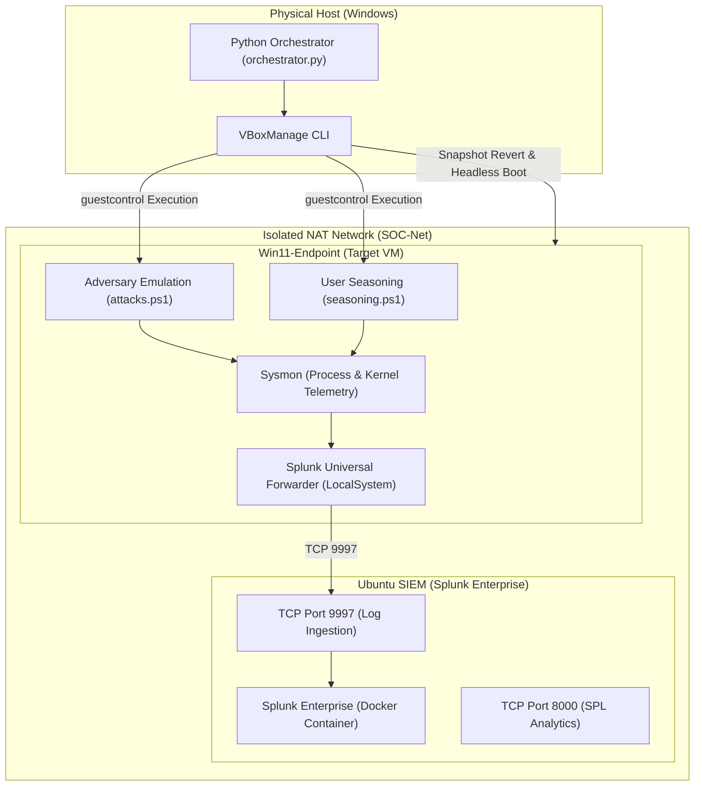
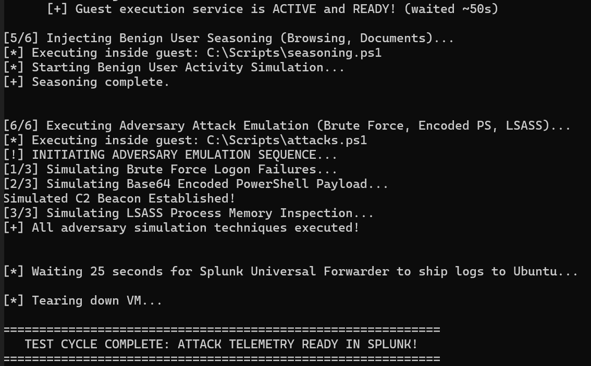
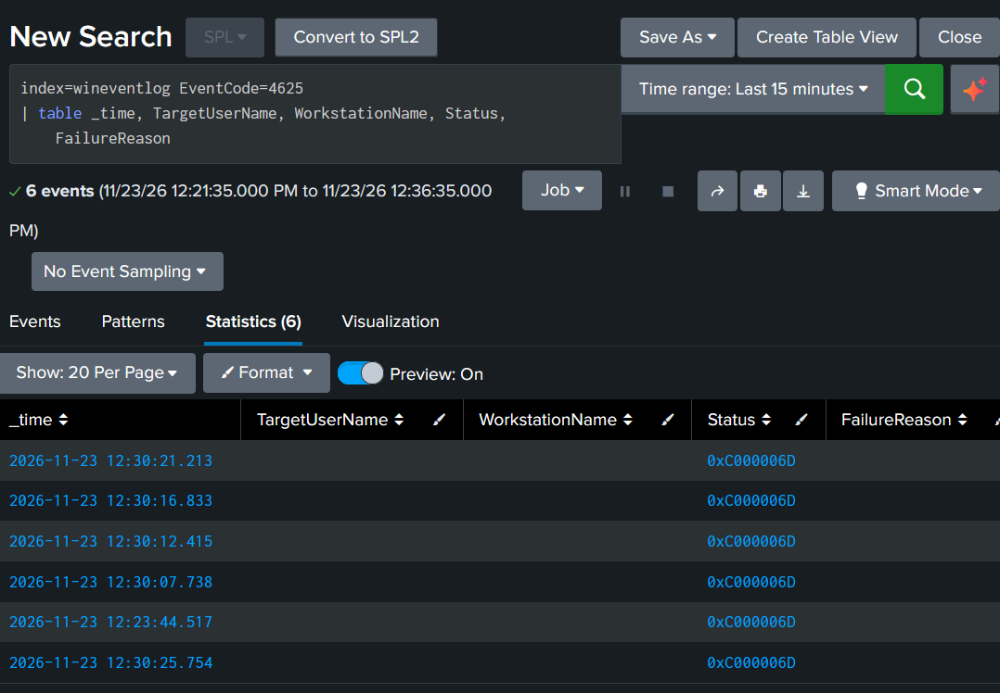
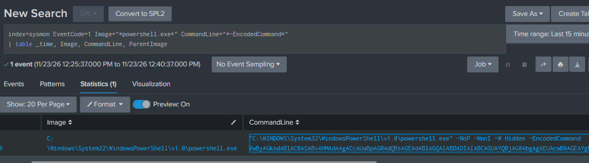
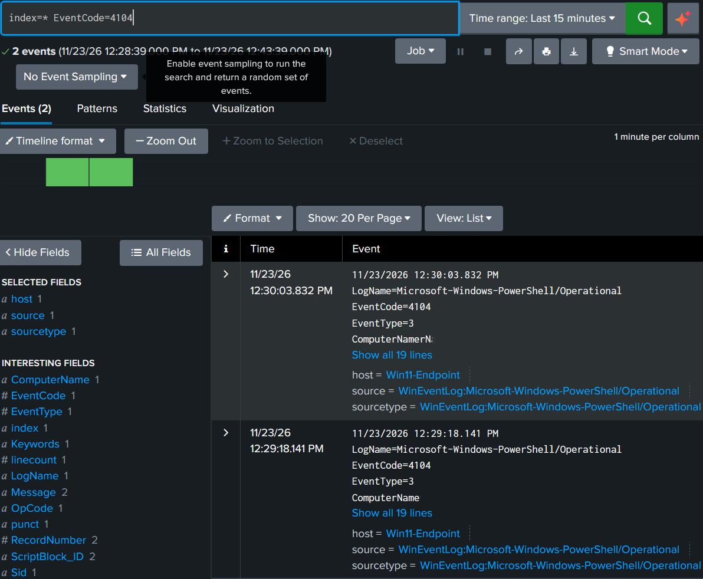
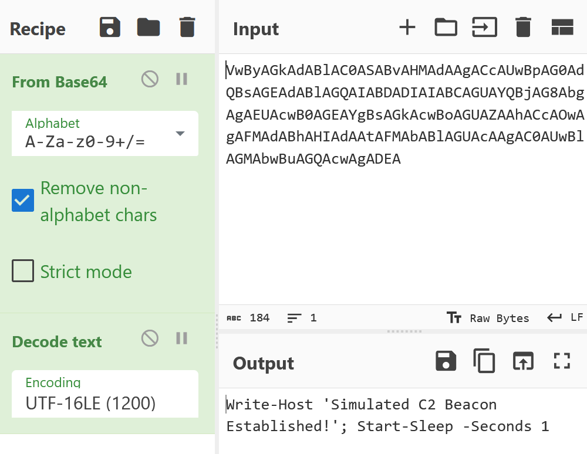

# Continuous Detection & Adversary Emulation Pipeline

An automated detection engineering and adversary emulation test harness built using Python, VirtualBox CLI (`VBoxManage`), Microsoft Sysmon, and Splunk Enterprise.

The pipeline automates the entire lifecycle of an enterprise endpoint: reverting to a clean baseline snapshot, launching headless, injecting benign user seasoning, triggering simulated cyberattacks mapped to **MITRE ATT&CK**, ingesting granular telemetry into a SIEM, and performing automated teardown.

---

## Architecture Diagram



---

## MITRE ATT&CK Mapping & Detection Verification

| Technique | ATT&CK ID | Telemetry Source | Event ID | Indicator / Signature |
| :--- | :--- | :--- | :---: | :--- |
| **Brute Force** | **T1110** | Windows Security | `4625` | Rapid failed logon attempts with status `0xC000006D`. |
| **Obfuscated PowerShell** | **T1059.001** | Sysmon / PowerShell | `1` / `4104` | Execution with `-W Hidden -EncodedCommand` flags. |
| **Credential Access** | **T1003.001** | Sysmon | `10` | Unauthorized process handle requests to `lsass.exe`. |
| **User Seasoning** | Benign Baseline | Sysmon | `1` / `11` | Normal web browsing and office productivity activity. |

---

## Evidence & Telemetry Validation

### 1. Automated Pipeline Execution
The Python orchestrator cleanly executes the VM lifecycle, waits dynamically for guest services (~50s), runs the payload, flushes logs, and terminates the guest.



---

### 2. Brute Force Detection (Event ID 4625)
Splunk identifies repeated failed authentication attempts within seconds:
```spl
index=wineventlog EventCode=4625 
| table _time, TargetUserName, WorkstationName, Status, FailureReason
```


---

### 3. Obfuscated PowerShell Dropper (Sysmon Event ID 1)
Sysmon captures the hidden window and Base64 encoded payload:
```spl
index=sysmon EventCode=1 Image="*powershell.exe*" CommandLine="*-EncodedCommand*"
| table _time, Image, CommandLine, ParentImage
```


---

### 4. PowerShell ScriptBlock Logging (Event ID 4104)
Windows PowerShell operational logs record the script block execution in memory:
```spl
index=* EventCode=4104
| table _time, EventCode, ScriptBlockText
```


---

### 5. Payload Deobfuscation (CyberChef)
Decoding the captured Base64 payload reveals the attacker's simulated C2 beacon:
* **Input:** `VwByAGkAdABlAC0ASABvAHMAdAAgACcAUwBpAG0AdQBsAGEAdABlAGQAIABDADIAIABCAGUAYQBjAG8AbgAgAEUAcwB0AGEAYgBsAGkAcwBoAGUAZAAhACcA...`
* **Recipe:** `From Base64` $\rightarrow$ `Decode text (UTF-16LE)`
* **Decoded Output:** `Write-Host 'Simulated C2 Beacon Established!'; Start-Sleep -Seconds 1`



---

## Key Takeaways & SOC Analyst Insights

1. **Service Account Permissions Matter:** The Splunk Universal Forwarder defaults to `NT AUTHORITY\Network Service`, which Windows 11 blocks from reading the `Microsoft-Windows-Sysmon/Operational` channel (`errorCode=5`). Reconfiguring the service account to `LocalSystem` successfully enabled full event subscription.
2. **Signal vs. Noise Tuning:** SwiftOnSecurity’s Sysmon configuration actively filters out benign file extensions (like `.txt`) to prevent storage exhaustion, illustrating why detection engineers must balance visibility with alert fatigue.
3. **Automated Consistency:** Using `VBoxManage` CLI ensures every test run begins from an identical, uncontaminated baseline snapshot, eliminating analyst bias and configuration drift.